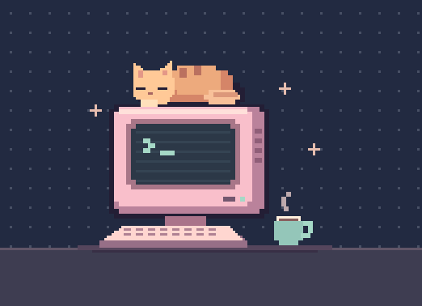

  <a href="https://nhqd.vercel.app/"><picture>
    <source media="(prefers-reduced-motion: reduce)" srcset="./profile-banner.png">
    
  </picture></a>

<strong><a href="https://nhqd.vercel.app/">Trang cá nhân ↗</a></strong> &nbsp; · &nbsp; <a href="https://facebook.com/dgx14th6">Facebook</a> &nbsp; · &nbsp; <a href="https://www.tiktok.com/@_.qocdug146._">TikTok</a>

## 🇻🇳 Thông tin cá nhân · Personal info

<table>
  <tr>
    <td width="35%" align="center"></td>
    <td>
      <strong>Nguyễn Hoàng Quốc Dũng</strong> 
      <code>@nhqdung</code>  
      Quê Phú Yên, hiện sống ở TP. Hồ Chí Minh. 
      Sinh viên Công nghệ thông tin, mê thiết kế giao diện web.
    </td>
  </tr>
</table>

## ✦ Về mình · About me

Mình có thể ngồi chỉnh đi chỉnh lại một chuyển động chỉ để chiếc nút trông như khẽ nảy lên khi bạn bấm. Mình cũng thích giấu một chi tiết nhỏ ở góc trang, kiểu như chú mèo đang ngủ ngay phía trên. Nếu bạn vô tình bắt gặp nó, coi như tụi mình vừa chào nhau.

<code>React</code> &nbsp; <code>Next.js</code> &nbsp; <code>TypeScript</code> &nbsp; <code>Tailwind CSS</code>

## ♫ Ngoài giờ code · Off the clock

<strong>Mở playlist và ngồi chơi một chút</strong>

Mình thích nghe lofi lúc ngồi với một ly cà phê sữa. Khi muốn đổi nhịp thì có remix, mixtape hoặc một ván FPS. Còn nếu thấy sticker mèo dễ thương, kiểu gì mình cũng lưu lại.

[Qua trang cá nhân nghe nhạc cùng mình ↗](https://nhqd.vercel.app/)

---

<em>Cảm ơn bạn đã ghé góc nhỏ của mình.</em> <strong>Dũng</strong>

